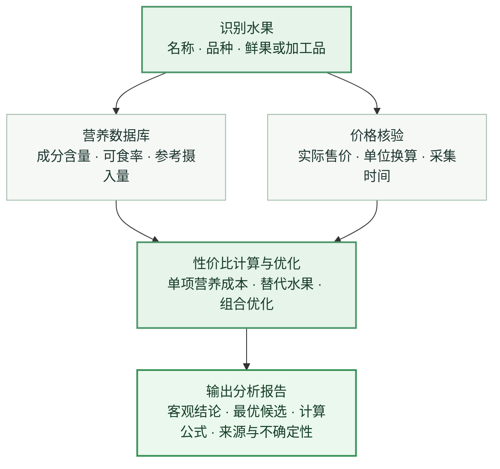

<div align="center">


# 🍌 Fruit Nutrition Optimizer

**水果营养性价比优化 Skill**

### 以最低实际成本，实现最大化的有效水果营养收益。

基于可追溯的食物成分数据、实际购买价格及营养约束，系统比较水果的单位营养获取成本，识别更经济的替代选择，并优化预算内的水果采购组合。

[](SKILL.md)
[](RELEASE-NOTES.md)
[](https://github.com/ryb792/fruit-nutrition-optimizer/actions/workflows/tests.yml)
[](LICENSE)
[](https://fdc.nal.usda.gov/)

</div>

## 能做什么？

| 你可以这样提问 | Skill 将如何分析 |
| --- | --- |
| **“猕猴桃有哪些主要营养？”** | 查询营养素含量，并给出可核验的数据出处 |
| **“香蕉和樱桃谁更划算？”** | 根据每元实际可获取的营养量，而非仅凭售价比较 |
| **“补充维生素C买什么水果最省钱？”** | 对目标营养素排序，寻找低成本替代水果 |
| **“每周20元，怎么搭配水果？”** | 在预算、可食量和营养约束下求解采购与食用组合 |
| **“樱桃降到多少钱值得买？”** | 计算单项营养成本相等时的临界售价 |

可以输入**水果名称**，也可以在支持视觉输入的 AI 环境中**上传水果照片**。照片用于识别品类；营养含量仍须依据食物成分数据库，不会凭照片臆测。

**普通用户无需配置 API 密钥。** 内置条目直接查询；遇到未收录水果，具备联网能力的 Agent 会查找官方公开网页或下载数据，核对品种、单位和可食部后，通过 `import-web` 导入并继续计算。联网检索由 Agent 宿主提供，Python 命令行负责证据校验和数值计算。原有 USDA FDC API 导入继续保留，供开发者按需使用。

## 分析流程



## 核心计算依据

**① 单项营养素的单位成本效率**

$$
E_{ij}=\frac{10\,N_{ij}\,R_i\,(1-L_i)}{P_i}
$$

- $E_{ij}$：水果 $i$ 每花费 1 元可获得的营养素 $j$ 的数量；
- $N_{ij}$：每 100 g **可食部分**的营养素含量；
- $P_i$：每 kg **购入总重量**的实际价格（元）；
- $R_i$：去皮去核后的可食率；$L_i$：额外损耗率（不重复计算果皮果核）。

**② 多水果的最低成本组合**

$$
\min \sum_i P_i x_i
\qquad
\text{满足}\quad \sum_i 10\,x_i R_i(1-L_i)N_{ij}\ge T_j
$$

其中 $x_i$ 为购入重量（kg），$T_j$ 为明确设定的**水果部分**营养目标。实际求解还会加入预算、每日食用量、包装规格、保存期限等约束。对于没有唯一优胜者的多营养目标，使用**帕累托分析**呈现非劣候选，不以主观加权分数制造“水果冠军”。

> **优化边界：** 最优结果只针对已纳入的候选水果、可核验价格及用户给定约束成立；水果营养优化不能代替全天完整膳食评价。

## 安装 Agent Skill

**GitHub 项目地址：** [https://github.com/ryb792/fruit-nutrition-optimizer](https://github.com/ryb792/fruit-nutrition-optimizer)

本项目采用 **Agent Skills** 目录结构，以 `SKILL.md` 定义分析流程，并通过 `fruit_optimizer/`、`data/` 和 `references/` 提供可复算的数据与计算能力。**安装入口、技能目录和可执行权限由实际使用的 Agent 平台决定**；并非所有 Agent 都支持直接安装或运行技能。

### 方式一：通过 Agent 安装

在支持 Agent Skills、能够访问 GitHub 并具备安装权限的 Agent 中，发送以下指令：

> 请从 https://github.com/ryb792/fruit-nutrition-optimizer 安装 `fruit-nutrition-optimizer` Agent Skill。
>
> 先检查仓库中的 `SKILL.md`、项目文件、依赖和相关安全风险。按**当前 Agent 平台的官方 Skill 安装方式**，将完整技能目录安装或导入到可用的技能位置，不要套用其他 Agent 的专属路径。
>
> 保留 `SKILL.md`、`fruit_optimizer/`、`data/`、`references/`、`requirements.txt` 的相对目录结构。若环境支持 Python 3.11+ 和执行权限，请在合适的隔离环境安装依赖、运行 `python -m pytest tests -q`，并试用一次水果营养查询。
>
> 完成后报告实际安装或导入位置、技能是否可用、测试结果及是否需要重新加载。如果平台不支持自动安装、没有仓库访问权限或无法执行测试，请如实说明，并提供符合当前平台要求的手动安装步骤；不要声称未实际完成的操作已经成功。

安装后，可直接提问：“**使用 fruit-nutrition-optimizer 分析猕猴桃的营养性价比**”或“**一周水果预算 30 元，怎样组合更经济？**”。如未识别新技能，按所用平台的说明重新加载技能或会话。

### 方式二：手动导入技能目录

1. 打开 GitHub 项目地址，选择 **Code → Download ZIP**，解压后保留完整项目目录。
2. 确认技能根目录存在 `SKILL.md`，并包含 `fruit_optimizer/`、`data/`、`references/` 和 `requirements.txt`。
3. 在当前 Agent 平台的文档或设置中找到 **Skills / Agent Skills** 的安装入口、导入方式或技能目录，将**整个目录**导入。不同 Agent 的目录和权限要求可能不同，不存在通用的固定安装路径。
4. 按平台要求加载技能。如环境支持 Python 执行，安装 `requirements.txt` 所列依赖后可以使用精确数值计算。
5. 进行一次水果查询，确认技能已加载；需要预算组合优化时，还应验证计算脚本能够运行。

完整说明见 [Agent Skill 安装指南](docs/INSTALL-SKILL.md)。

### 使用示例

> **香蕉和樱桃，哪一种补钾的实际成本更低？列出数据来源、可食率和计算公式。**

> **一周水果预算 30 元，找出三种水果的低成本组合，并说明是否使用了模拟价格。**

**价格说明：** 本 Skill 不会凭空生成实时零售价。请提供可核验的小票、价签或商品报价，或允许使用明确标注的假设情景；两者不得混淆。**精确数值求解需要 Python 及相应依赖与执行权限**，不能仅因 Agent 读取 `SKILL.md` 就宣称计算已经完成。

## 数据可信度

- **营养数据：** 内置 8 种常见鲜果的 [USDA FoodData Central](https://fdc.nal.usda.gov/) SR Legacy 历史条目，附 FDC ID 和来源链接；不是用户所买水果的实测值。
- **免密钥补充：** Agent 可核验官方网页或公开 CSV/JSON，并保存原值、单位、条目定位、访问日期和证据哈希。附带一条来自 USDA 官方下载包的 Tommy Atkins 芒果证据示例，导入后可扩展到 9 条；其他品种需另外查证。步骤与格式见 [联网数据导入](references/web-retrieval.md)。
- **价格与可食率：** 优先采用可核验的实际售价；当前内置价格仅为**模拟演示**。部分可食率、储存期限是明确标注的规划假设。
- **适用范围：** 目前仅能在已纳入的水果候选中排名；数据缺失不会被当作零，也不能把营养素直接叠加为未经验证的综合评分。

详见 [数据来源与许可](DATA-LICENSE.md) 和 [计算规则](references/methodology.md)。

## 进阶使用与测试

需要自建价格数据库、扩展水果条目或独立运行优化算法时，可使用 Python 3.11+ 命令行计算引擎。请阅读 [开发者与命令行指南](docs/ADVANCED.md)。

```bash
python -m pip install -r requirements.txt
python -m pytest tests -q
```

当前版本本地自动化测试 **135 项通过**。已验证免密钥下载 USDA 官方公开数据、导入芒果条目并继续查询、对比和优化；详见 [测试说明](docs/TESTING.md)。开发者 FDC API 采用模拟 HTTP 回归测试；真实照片识别尚未通过端到端环境验证。

## 开源协议

本项目代码采用 [MIT License](LICENSE)。食物成分数据及其他第三方资料遵循各自的数据许可，不能因仓库采用 MIT 而被视为统一授权。欢迎通过 Issue / Pull Request 提供可追溯的数据与修正，参见 [贡献指南](CONTRIBUTING.md)。

*本 Skill 用于营养信息与采购成本分析，不构成医疗诊断或个体化膳食处方。*

